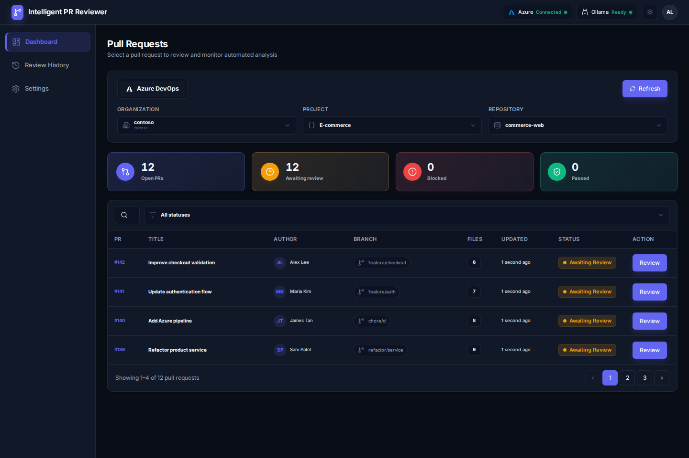
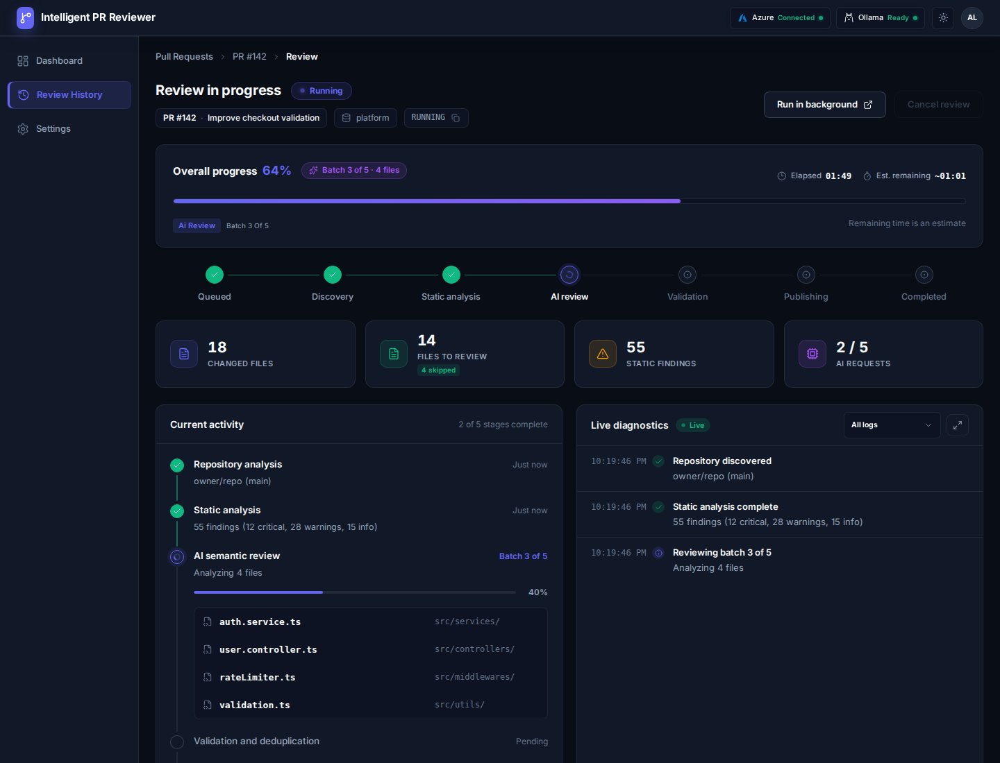
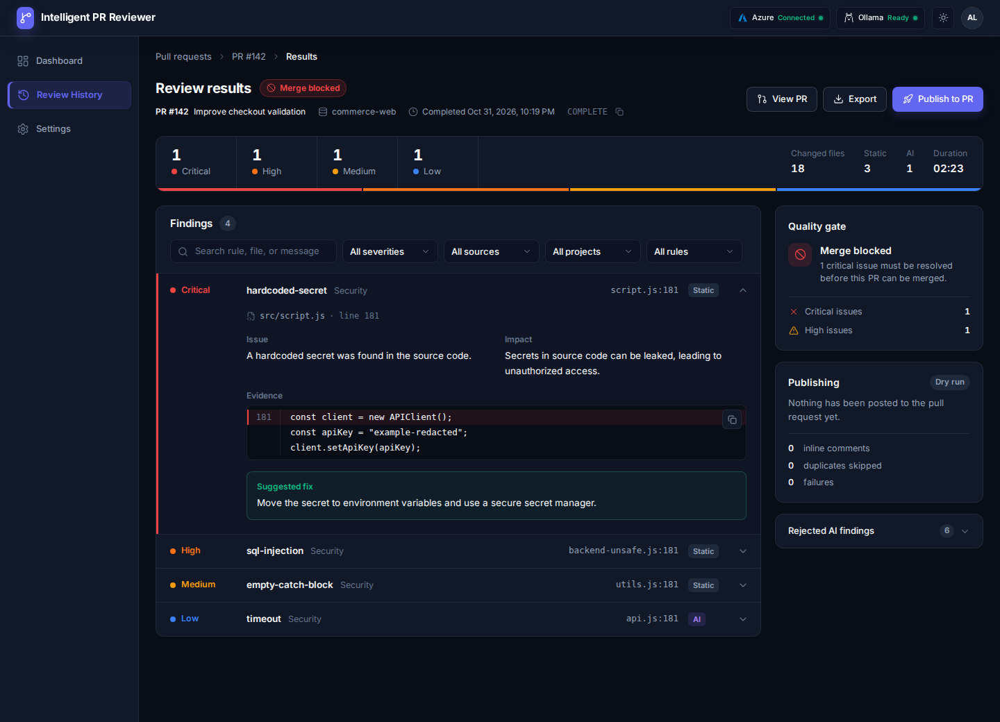
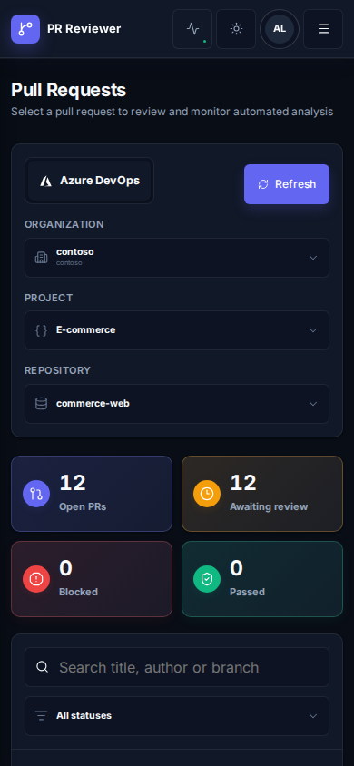
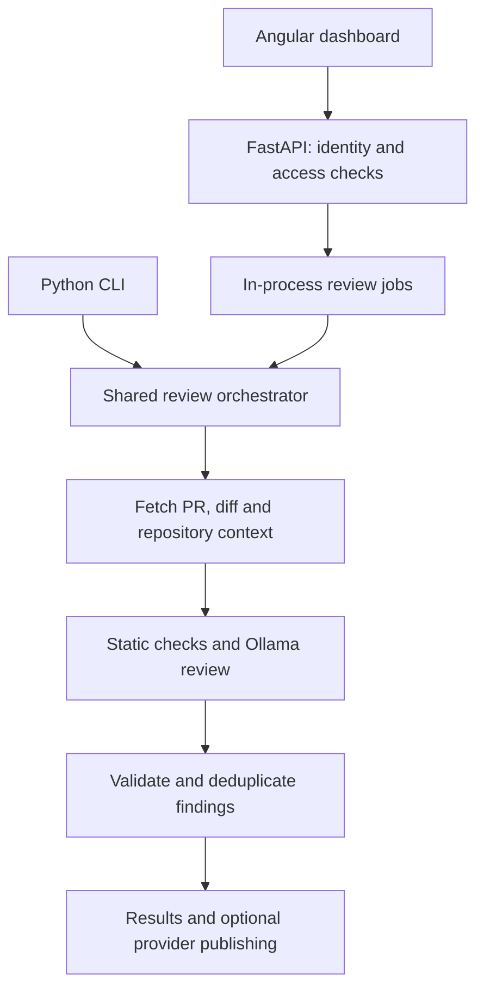

# Intelligent PR Reviewer

**A shared workspace for evidence-grounded pull request reviews across GitHub and Azure DevOps.**

Intelligent PR Reviewer combines deterministic code analysis with AI-assisted review through Ollama. It brings repository discovery, review progress, findings, and publishing into an Angular dashboard backed by a Python review engine.

The project explores a practical question: as AI-assisted development makes writing code faster, how can teams support the people responsible for reviewing it?

Reviewers can inspect findings before publishing feedback. Engineering leads and managers can follow review progress and outcomes. Automated analysis supports human judgment; it does not establish that a change is safe to merge.

**Project status:** core workflows are implemented. Production hardening and broader framework validation are ongoing. See [current limitations](#current-limitations).

[Features](#features) · [Screenshots](#screenshots) · [Architecture](#architecture) · [Getting started](#getting-started) · [Framework coverage](#language-and-framework-coverage) · [Testing](#testing)



*Screenshots show the application interface with sample data. They are not measurements of live provider or model performance.*

## Features

### Repository access

- Sign in with GitHub or Microsoft for Azure DevOps.
- Show login options according to server configuration.
- Discover repositories available to the signed-in account.
- Browse GitHub accounts/organizations and Azure DevOps organizations/projects.
- Enforce repository access and publishing permissions on the backend.
- Show an access screen when no accessible repositories are returned.

### Review workflow

- Inspect pull request metadata, changed files, and available change statistics.
- Run a dry review without posting comments.
- Choose fast, standard, or deep review depth.
- Follow progress, analysis stages, batch activity, and diagnostic events.
- Filter findings by severity, source, project, rule, or search text.
- Inspect issue descriptions, evidence, impact, and suggested fixes when available.
- Export review results and review history as JSON.

### Publishing and interface

- Require explicit confirmation before publishing from the web interface.
- Check publishing permission separately from review permission.
- Validate findings against changed code and reduce duplicate feedback.
- Publish inline comments and review summaries through provider integrations.
- View review history for the current backend process.
- Use light/dark themes, responsive layouts, and mobile navigation.
- Run the shared review engine through a CLI as well as the web application.

## Screenshots

### Review progress



### Findings and review decision



The quality-gate decision shown in the application is an assessment of its findings. Displaying “Merge blocked” does not by itself configure a required GitHub status check or Azure DevOps branch policy.

### Mobile interface



## Architecture

The Angular client calls FastAPI. The API handles sign-in, access checks, provider discovery, and review-job endpoints. Web jobs and the CLI use the same review orchestrator.



| Layer | Implementation |
| --- | --- |
| Web interface | Angular 20, TypeScript, signals, RxJS, SCSS, Lucide icons |
| API | Python 3.12+, FastAPI, HTTPX |
| Review engine | Context detection, static analysis, semantic routing, finding validation, quality gate |
| AI integration | Ollama with a configurable model and endpoint |
| Providers | GitHub and Azure DevOps |
| Identity storage | SQLite sessions and encrypted provider credentials |
| Review-job storage | In-process memory; not persistent across restarts |
| Tests | pytest; Jasmine/Karma for Angular |

## Language and framework coverage

Coverage varies by language, file type, available repository context, selected review depth, and model output. Recognizing a framework does not imply comprehensive framework-specific analysis.

| Area | Current implementation |
| --- | --- |
| JavaScript / TypeScript | Dedicated deterministic analyzers and semantic review |
| Angular | Dedicated static checks, template-usage analysis, and framework-aware validation |
| React web | Dedicated static checks, framework-fact validation, and React regression tests |
| Python | Dedicated analyzer and Python/backend-oriented review support |
| Java / Spring | Java analyzer, framework detection, and review guidance |
| C# / ASP.NET Core | .NET analyzer, framework detection, and review guidance |
| Vue / Nuxt | Framework detection and AI review guidance; `.vue` semantic routing exists, but Vue single-file components do not enter the JavaScript-specific static-analysis path |
| React Native | Framework detection and native-oriented AI guidance, with applicable JS/TS/React checks; dedicated native-behavior regression coverage needs expansion |
| Other text/source files | May enter generic or semantic review; analysis depth varies |

Vue and React Native should be treated as partial coverage, rather than advertised as comprehensively validated support. See the [tests](tests/) and [analyzers](src/pr_reviewer/review/) for the implemented behavior.

## Getting started

### Prerequisites

- Python **3.12 or later**.
- [uv](https://docs.astral.sh/uv/getting-started/installation/) for Python dependencies and commands.
- A Node.js version supported by Angular 20, such as **Node 22.12+ on the 22.x line** or **Node 24.x**, with npm.
- [Ollama](https://docs.ollama.com/quickstart) running locally or at a reachable configured endpoint.
- A GitHub OAuth application and/or a Microsoft Entra application for web sign-in.
- A user account with access to the repositories you want to review.

Identity-provider registration is required for the web sign-in flow. The CLI uses a separate credential configuration described below.

### 1. Clone and install

```bash
git clone https://github.com/Abhilash-A-S/intelligent-pr-reviewer.git
cd intelligent-pr-reviewer
uv sync --locked
```

Create your private environment file.

**Windows PowerShell:**

```powershell
Copy-Item .env.example .env
```

**macOS / Linux:**

```bash
cp .env.example .env
```

Keep the real `.env` outside version control. The committed [`.env.example`](.env.example) is the configuration template.

### 2. Generate the connection-encryption key

```bash
uv run python -c "from cryptography.fernet import Fernet; print(Fernet.generate_key().decode())"
```

Copy the output into `.env` as `PR_REVIEW_CONNECTION_KEY`.

Generate this key once per installation and preserve it across restarts and upgrades. Replacing it makes existing encrypted provider credentials unreadable. Keep backups of the key separate from source control.

### 3. Choose sign-in providers

Set `PR_REVIEW_ENABLED_PROVIDERS` in `.env`:

| Login options | Value |
| --- | --- |
| GitHub only | `github` |
| Microsoft / Azure DevOps only | `azure-devops` |
| Both | `github,azure-devops` |

Configure credentials for each provider you enable. Disabled providers do not need client credentials for this flow.

### 4. Configure Microsoft sign-in for Azure DevOps

For this implementation, register a confidential **Web** application in the Microsoft Entra tenant used for your organizational sign-in.

1. Register the application in Microsoft Entra ID using the single-tenant account option.
2. Add a **Web** redirect URI: `http://localhost:8000/api/auth/callback`.
3. Configure Azure DevOps delegated API access, including `user_impersonation`, and obtain any consent required by your tenant.
4. Create a client secret and copy its **value**, not the secret's ID.
5. Set the following values in your private `.env`:

```dotenv
PR_REVIEW_ENTRA_TENANT_ID=your_tenant_id
PR_REVIEW_OIDC_CLIENT_ID=your_application_client_id
PR_REVIEW_OIDC_CLIENT_SECRET=your_client_secret_value
```

The signed-in identity must also have the required Azure DevOps membership and repository permissions. Successful Microsoft authentication alone does not grant repository access. Personal-account and guest-account scenarios depend on their tenant and Azure DevOps identity configuration; do not assume arbitrary personal Microsoft accounts will work.

Official reference: [Microsoft Entra OAuth for Azure DevOps](https://learn.microsoft.com/en-us/azure/devops/integrate/get-started/authentication/entra-oauth).

### 5. Configure GitHub sign-in

This implementation uses a **GitHub OAuth App**, not a GitHub App installation.

1. Open GitHub **Settings → Developer settings → OAuth Apps** and create an application.
2. Set the homepage URL to `http://localhost:8000`.
3. Set the authorization callback URL to `http://localhost:8000/api/auth/github/callback`.
4. Generate a client secret and configure your private `.env`:

```dotenv
PR_REVIEW_GITHUB_CLIENT_ID=your_github_oauth_client_id
PR_REVIEW_GITHUB_CLIENT_SECRET=your_github_oauth_client_secret
```

The current authorization request asks for `repo` and `read:user`. Repository access still depends on the user's permissions and any applicable organization approval or SSO requirements. The `repo` scope is broad; review the requested authorization before using the application with organizational repositories.

Automatic token refresh is not implemented. When provider authorization expires or is revoked, sign in again.

Official references: [Create an OAuth App](https://docs.github.com/en/apps/oauth-apps/building-oauth-apps/creating-an-oauth-app) and [OAuth scopes](https://docs.github.com/en/apps/oauth-apps/building-oauth-apps/scopes-for-oauth-apps).

### 6. Prepare Ollama

Install and start Ollama, then download the configured model:

```bash
ollama pull qwen2.5-coder:7b
```

If Ollama is not already running as an application or service, start it in another terminal:

```bash
ollama serve
```

The default configuration is:

```dotenv
OLLAMA_MODEL=qwen2.5-coder:7b
OLLAMA_BASE_URL=http://localhost:11434
OLLAMA_READ_TIMEOUT=300
```

Choose a model your machine can run. Review duration and resource requirements depend on the model, hardware, pull request, and review depth. A running Ollama service must have the configured model available.

### 7. Build and run the web application

From the repository root:

```bash
cd web
npm ci
npm run build:embedded
cd ..
uv run intelligent-pr-reviewer-api
```

Open **[http://localhost:8000](http://localhost:8000)**.

The embedded build places the frontend under `src/pr_reviewer/web/static/`. FastAPI serves the frontend and `/api` endpoints from one application. Generated frontend files should be rebuilt rather than edited manually.

Use `localhost` consistently with the template's `PR_REVIEW_PUBLIC_URL` and registered callback URLs. Do not switch between `localhost` and `127.0.0.1` during sign-in.

### 8. Run your first review

1. Sign in with a configured provider.
2. Select an accessible account/organization, project where applicable, and repository.
3. Open a pull request and inspect its changed files.
4. Choose a review depth and run a **dry review**.
5. Follow progress, then inspect and verify the findings.
6. Publish only when you have permission and want comments posted to the provider.

Use a dedicated test pull request when first validating publishing behavior.

## Configuration reference

| Variable | Purpose / default |
| --- | --- |
| `PR_REVIEW_ACCESS_MODE` | `provider` for the documented web sign-in flow |
| `PR_REVIEW_PUBLIC_URL` | Canonical application URL; template uses `http://localhost:8000` |
| `PR_REVIEW_ENABLED_PROVIDERS` | Comma-separated `github`, `azure-devops`, or both |
| `PR_REVIEW_CONNECTION_KEY` | Installation-specific Fernet key for provider credentials |
| `PR_REVIEW_AUTH_DB` | SQLite identity/session database; template uses `data/auth.sqlite3` |
| `PR_REVIEW_API_HOST` / `PR_REVIEW_API_PORT` | API listener configuration; defaults are `127.0.0.1` / `8000` |
| `PR_REVIEW_UI_ORIGINS` | Allowed development frontend origins |
| `PR_REVIEW_MAX_JOBS` | Concurrent review jobs; default `1`, clamped to `1–4` |
| `PR_REVIEW_UI_FILE_COUNT_LIMIT` | Limit used for dashboard file-count enrichment; template uses `30` |
| `OLLAMA_MODEL` | Model name; template uses `qwen2.5-coder:7b` |
| `OLLAMA_BASE_URL` | Ollama service endpoint; default `http://localhost:11434` |
| `OLLAMA_READ_TIMEOUT` | Model-response read timeout in seconds; template uses `300` |

Application client IDs identify the registered application; they are not a separate registration for every user. Each user's authorization determines the provider credentials and repository access used by their session.

## Development

Run the API and Angular development server in separate terminals:

```bash
# Terminal 1 — repository root
uv run intelligent-pr-reviewer-api
```

```bash
# Terminal 2 — repository root
cd web
npm start
```

The Angular development server is available at `http://localhost:4200` and proxies `/api` requests to the backend. Complete OAuth sign-in at the configured canonical URL, `http://localhost:8000`, first, then open the development frontend on the same hostname.

The embedded application at port 8000 is the reference setup for end-to-end sign-in and state-changing actions. The current CSRF origin validation compares browser origins with `PR_REVIEW_PUBLIC_URL`; merely adding port 4200 to CORS origins does not make every write from the development frontend valid. A separate-origin development OAuth/CSRF setup needs additional configuration or implementation work.

## Testing

Build the embedded frontend **before** running the complete backend suite: the embedded-shell test expects those assets to exist.

```bash
uv sync --locked
cd web
npm ci
npm run build:embedded
npm run test:ci
cd ..
uv run pytest -q
```

`npm run test:ci` requires Chrome or Chromium. If necessary, set `CHROME_BIN` to the executable path for your system.

The automated tests cover analysis, context detection, routing, finding validation, publishing behavior, API access, authentication, jobs, and frontend interactions. Mocked provider/model tests do not replace live integration checks or an accuracy evaluation against representative pull requests.

The frontend build currently reports bundle-size and CSS-optimization warnings. A successful build is not a claim that every performance target is met. CI automation is a planned repository improvement.

To build Python distribution artifacts after the embedded frontend build:

```bash
uv build --clear
```

## CLI

The CLI uses server-side credentials independently of the web sign-in session. Configure `GITHUB_TOKEN` for GitHub or `AZURE_DEVOPS_PAT` for Azure DevOps in your private environment. The repository argument supplies the GitHub owner/repository or Azure DevOps organization/project/repository.

```bash
uv run intelligent-pr-reviewer --provider github --repository owner/repository --pull-number 1 --dry-run
```

```bash
uv run intelligent-pr-reviewer --provider azure-devops --repository organization/project/repository --pull-number 1 --dry-run
```

Inspect the dry-run findings before explicitly choosing `--publish`. Use credentials scoped for the intended repositories and actions. Shared CLI tokens are not required for the provider-based web login flow.

See all options with:

```bash
uv run intelligent-pr-reviewer --help
```

## Troubleshooting

| Symptom | What to check |
| --- | --- |
| Sign-in is not configured | Enabled providers, application client IDs/secrets, public URL, and connection key |
| Microsoft sign-in fails | Tenant, Web redirect URI, secret value/expiry, delegated Azure DevOps permissions, and consent |
| No accessible repositories | Signed-in identity, repository access, organization approval/SSO, and provider authorization expiry |
| OAuth redirect mismatch | Exact hostname, port, callback path, and `PR_REVIEW_PUBLIC_URL` |
| Ollama unavailable or model missing | Service endpoint, running process, and downloaded model name |
| Web page returns 404 after cloning | Run `npm ci` and `npm run build:embedded` from `web/` |
| Embedded-shell test returns 404 | Build the embedded frontend before running the backend suite |
| Review cannot be cancelled | Cancellation currently applies to queued jobs, with owner/administrator access checks |
| Review history disappears | History is held in backend process memory and is not restart-persistent |
| An action from port 4200 returns 403 | Check canonical-origin CSRF validation; CORS configuration alone does not authorize the request |

## Current limitations

- **Jobs and history are not durable.** Restarting the backend loses in-memory review jobs, results, and history. SQLite identity storage does not provide review-job persistence.
- **Cancellation is queue-only.** Running analysis is not cooperatively cancellable in the current engine.
- **Worker concurrency is bounded, but job intake is not a durable bounded queue.** Queue limits, retention, and recovery need additional work before wider deployment.
- **Automatic provider-token refresh is not implemented.** Expired or revoked authorizations require sign-in again.
- **Framework coverage is uneven.** Vue/Nuxt and React Native need more targeted regression and accuracy validation.
- **AI output requires verification.** Findings can be incomplete or incorrect; review them in the context of the product and repository.
- **The quality gate is an application decision.** Required provider-side merge policies are not automatically installed by the dashboard.
- **Performance and publishing outcomes vary.** Model latency, provider limits, repository permissions, and partial failures affect results. Publishing can write comments and should be tested on a suitable PR.

## Production readiness

This repository is suitable for evaluating the implemented workflows. A production rollout still requires work and environment-specific validation:

- Durable review storage, restart recovery, and job retention.
- Queue bounds, concurrent-user behavior, and failure recovery.
- Cross-user cancellation and access checks after permission revocation.
- Controlled accuracy testing, including safe-code samples and known issues.
- Publishing retries, duplicate prevention, and partial-failure handling.
- HTTPS, canonical public/callback URLs, secret management, observability, backups, and restore testing.

Configure production callback URLs using your real HTTPS hostname. Preserve the connection key and back up the identity database securely. Avoid assuming multiple API processes share jobs: the current in-memory manager is process-local.

## Project structure

| Path | Responsibility |
| --- | --- |
| [`web/`](web/) | Angular interface and frontend tests |
| [`src/pr_reviewer/web/`](src/pr_reviewer/web/) | FastAPI routes, authentication, provider access, and jobs |
| [`src/pr_reviewer/providers/`](src/pr_reviewer/providers/) | GitHub and Azure DevOps adapters |
| [`src/pr_reviewer/context/`](src/pr_reviewer/context/) | Repository and file context |
| [`src/pr_reviewer/detection/`](src/pr_reviewer/detection/) | Language, framework, project, workspace, and build detection |
| [`src/pr_reviewer/review/`](src/pr_reviewer/review/) | Analyzers, orchestration, validation, and quality gate |
| [`src/pr_reviewer/publishing/`](src/pr_reviewer/publishing/) | Inline feedback and summary publishing |
| [`tests/`](tests/) | Backend regression and integration-oriented tests |

## Roadmap

- Persistent review jobs and history with recovery behavior.
- Reliable running-job cancellation and bounded job intake.
- Deeper Vue and React Native validation.
- Automated CI and fresh-install verification.
- Provider authorization lifecycle improvements.
- Deployment and operational hardening.

## Feedback

Report reproducible bugs or propose improvements through [GitHub Issues](https://github.com/Abhilash-A-S/intelligent-pr-reviewer/issues). Include the expected behavior, actual behavior, and sanitized diagnostics. Do not include access tokens, client secrets, private source code, or sensitive review evidence in public issues.

## Author

Built by **Abhilash A S**.

[GitHub](https://github.com/Abhilash-A-S) · [LinkedIn](https://www.linkedin.com/in/abhilash-a-s-91248b145/)

## License

Intelligent PR Reviewer is licensed under the [MIT License](LICENSE).
